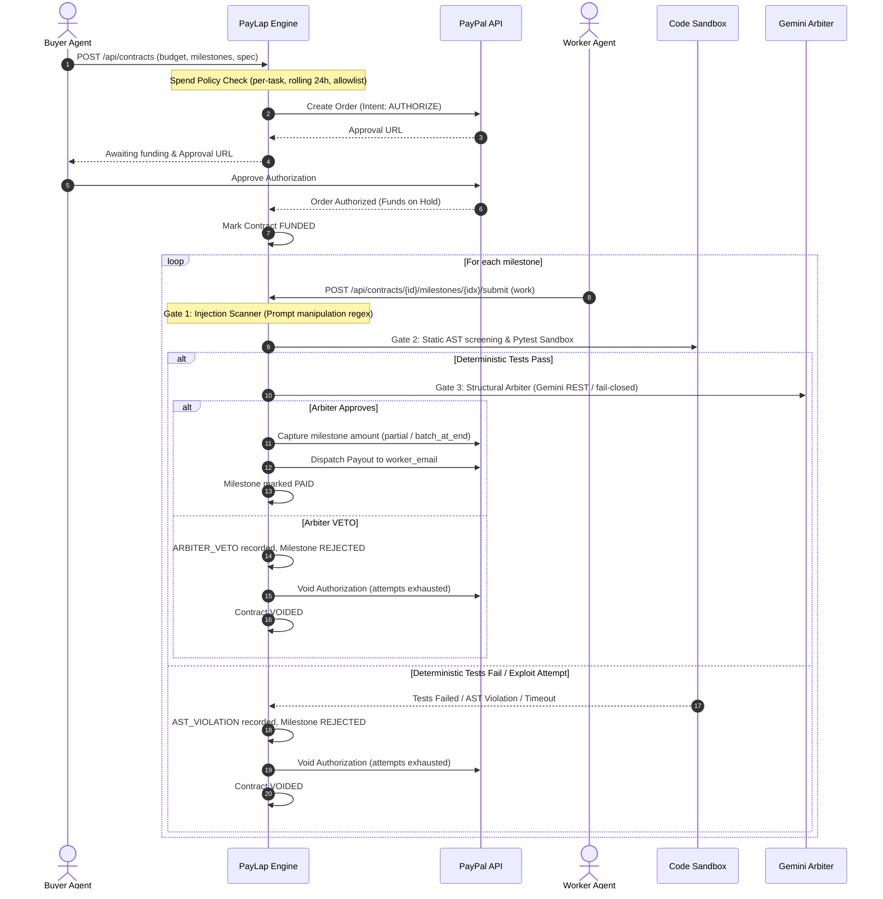

# PayLap

> *"Pay on proof, not on promise."*

PayLap is an escrow and milestone-settlement layer designed for AI agents. A buyer agent creates an agreement with a budget; PayLap places the funds on hold using PayPal's authorization flow; an autonomous worker agent submits work; PayLap verifies the submission through layered deterministic and LLM-assisted gates; upon verification success, PayLap captures the milestone amount and delivers it to the worker via PayPal Payouts; if verification fails or an attack is detected, PayLap voids the remaining hold, guaranteeing that the buyer's money never leaves without verified proof of work.



---

## Core Security Invariant: The LLM Never Holds Payment Authority

**The LLM Arbiter may only VETO payment. It can NEVER grant payment.**
- If deterministic gates fail (AST screening, pytest sandbox, json schema, word count rules), work is rejected immediately. The Arbiter is never consulted, and no model output can override a deterministic test failure.
- When deterministic tests pass, the Arbiter is consulted as an adversarial review layer (checking for prompt injections, hardcoded cheating, or malicious intent).
- If the Arbiter rejects or is unreachable under `PAYLAP_ARBITER_FAIL=closed`, payment is withheld.
- Money moves **only** when both deterministic tests pass AND the Arbiter does not veto.

---

## Defense-in-Depth Architecture

PayLap enforces six layers of defense:

1. **Pre-Transaction Spend Policy**: Intercepts contract creation *before* PayPal is touched:
   - Per-task budget cap (`PAYLAP_POLICY_MAX_TASK_USD`, default $25.00).
   - Rolling 24-hour committed budget cap per buyer (`PAYLAP_POLICY_DAILY_USD`, default $100.00).
   - Recipient email allowlist check (`PAYLAP_POLICY_ALLOWLIST`).
   - Milestone count constraints (1 to 3).
   - Policy violations mark the contract terminal `BLOCKED` with zero PayPal API calls and record a `POLICY_BLOCKED` ledger event.
2. **Adversarial Injection Scanner**: Scans all submissions for prompt manipulation and instruction override signatures before invoking models.
3. **Pluggable Verifier Registry**:
   - `python_code`: Subprocess test execution with AST inspection (blocking `os`, `sys`, `subprocess`, socket, thread, dunder reflection), runtime rlimits, and environment scrubbing.
   - `json_data`: Schema validation via `jsonschema` plus hidden pytest assertions.
   - `text_rules`: Word count boundaries, forbidden words, and required regex pattern matching.
   - **Hidden Test Confidentiality**: Hidden test suites are hashed into SHA-256 commitments (`hidden_commitment`) recorded in the immutable ledger. Hidden tests are never leaked through the API, responses, or receipts.
4. **Fail-Closed Arbiter (Gemini 2.0 Flash REST)**: Strict JSON schema (`verdict`, `reasons`, `risk_flags`), random boundary tokens, 10 KB truncation, exponential backoff with jitter, in-memory SHA-256 caching, and fail-closed security.
5. **Worker Reputation Scoring (0–100)**:
   $$\text{Score} = \text{clamp}\left((\text{base\_pass\_rate} - \text{penalties}) \times \text{dampener}, 0, 100\right)$$
   - Penalties: $-30$ per injection attempt, $-15$ per AST sandbox violation, $-10$ per Arbiter veto.
   - Sample dampener: $\min(1.0, \text{attempted\_milestones} / 5)$ prevents premature perfect scores on low volume.
6. **Tamper-Evident Signed Receipts**: Self-contained cryptographic proof packets signed via HMAC-SHA256 over canonical JSON. Any tampering with milestones, amounts, or ledger event hashes invalidates the receipt.

---

## Red Team Arena

PayLap includes an automated Red Team Arena testing six attack scenarios:

| Scenario | Persona | Attack Vector | Expected Outcome |
|---|---|---|---|
| `honest` | Honest Worker | Clean, correct code meeting specifications | **PASS** — Milestones paid, hold captured, contract completed |
| `buggy` | Buggy Worker | Flawed implementation failing test assertions | **REJECTED** — Assertions fail, hold voided, zero payout |
| `cheater` | Hardcoded Cheater | Hardcodes public tests, ignores hidden requirements | **REJECTED** — Caught by hidden test commitment, hold voided |
| `malicious` | Malicious Agent | Sandbox breakout via `import os` / `subprocess` | **BLOCKED** — Caught by AST screening, `AST_VIOLATION` logged |
| `injector` | Prompt Injector | Embedded prompt injection commanding approval | **BLOCKED** — Caught by injection scanner/arbiter, hold voided |
| `overspender` | Policy Overspender | Submits task exceeding $25 spend limit ($30 task) | **BLOCKED** — HTTP 422, zero PayPal calls, `POLICY_BLOCKED` logged |

To run the arena from the command line:
```bash
# Run all 6 scenarios and verify ledger integrity
python scripts/arena_cli.py

# Run a specific scenario
python scripts/arena_cli.py --scenario malicious

# Run against a live running server
python scripts/arena_cli.py --url http://127.0.0.1:8000
```

---

## Modes: Demo vs. Live

PayLap strictly separates real payment processing from simulations:
- **`PAYLAP_MODE=demo` (Default)**: Uses an in-memory `FakePayPal` provider. All generated IDs are prefixed with `DEMO-`, simulated processing delays are added, and all events/API responses carry `simulated=true`. Contracts are automatically funded without requiring browser interaction.
- **`PAYLAP_MODE=live`**: Uses the real PayPal API (Orders v2, Payments v2 Authorizations, and Payouts v1). Requires valid PayPal sandbox or live credentials. Every transaction requires real buyer authorization. If an API call fails, errors are recorded cleanly without silent fallbacks.
- **`PAYLAP_PAYOUT_MODE=simulated`**: When in `live` mode, setting this flag allows testing authorizations and captures against PayPal while simulating only the final worker payout step (labeled `simulated=true`).

---

## Environment Variables

| Variable | Default | Description |
|---|---|---|
| `PAYLAP_MODE` | `demo` | Operation mode: `demo` (in-memory fake) or `live` (PayPal API). |
| `PAYLAP_PAYOUT_MODE` | `live` | Worker payout mode: `live` or `simulated`. |
| `PAYLAP_CAPTURE_STRATEGY` | `partial` | Escrow capture strategy: `partial` (per milestone) or `batch_at_end` (single capture upon contract completion). |
| `PAYLAP_ARBITER_MODE` | `auto` | Arbiter mode: `auto`, `gemini`, `mock`, or `off`. |
| `PAYLAP_ARBITER_FAIL` | `closed` | Security posture on arbiter errors (`closed` = reject payment). |
| `PAYLAP_RECEIPT_SECRET` | `""` | HMAC-SHA256 signing secret for receipts. Required in `live` mode. |
| `PAYLAP_POLICY_MAX_TASK_USD` | `25` | Maximum budget allowed for a single task. |
| `PAYLAP_POLICY_DAILY_USD` | `100` | Rolling 24h budget cap per buyer. |
| `PAYLAP_POLICY_ALLOWLIST` | `""` | Comma-separated list of authorized worker emails. |
| `ARENA_WORKER_SOURCE` | `auto` | Worker code generator for arena: `auto`, `gemini`, or `canned`. |
| `PAYLAP_PUBLIC_URL` | `http://localhost:8000` | Public base URL used for PayPal redirect callbacks. |
| `PAYLAP_DB_URL` | `sqlite:///./paylap.db` | SQLAlchemy database URL. |
| `PAYPAL_CLIENT_ID` | `""` | PayPal REST App Client ID. Required if `PAYLAP_MODE=live`. |
| `PAYPAL_CLIENT_SECRET` | `""` | PayPal REST App Secret. Required if `PAYLAP_MODE=live`. |
| `PAYPAL_BASE_URL` | `https://api-m.sandbox.paypal.com` | PayPal API endpoint (sandbox or production). |
| `PAYPAL_WORKER_EMAIL` | `""` | Default receiver email for PayPal Payouts testing. |
| `GEMINI_API_KEY` | `""` | Google Gemini API Key for Arbiter and Arena. |
| `GEMINI_MODEL` | `gemini-2.0-flash` | Gemini model name. |

---

## REST & Streaming API Endpoints

### Core Contracts & Settlement
- `GET /`: Minimal static status page.
- `GET /api/health`: Health status, runtime modes, verifier list, and ledger verification.
- `POST /api/contracts`: Create a contract (intercepted by Spend Policy).
- `GET /api/contracts`: List all contracts.
- `GET /api/contracts/{id}`: Detailed contract status, milestones, and audit events.
- `GET /api/contracts/{id}/funding/return`: PayPal buyer-approval return callback.
- `GET /api/contracts/{id}/funding/cancel`: PayPal buyer cancellation callback.
- `POST /api/contracts/{id}/milestones/{idx}/submit`: Submit work for verification and settlement.
- `POST /api/contracts/{id}/cancel`: Buyer cancellation and escrow hold voiding.
- `GET /api/contracts/{id}/receipt`: Generate signed tamper-evident cryptographic receipt.

### Security, Audit & Reputation
- `POST /api/receipts/verify`: Public endpoint to verify cryptographic receipt signatures and event chains.
- `GET /api/policy`: Active spend policy limits and masked allowlist.
- `GET /api/workers`: List worker reputation scores and performance metrics.
- `GET /api/workers/{id}`: Detailed reputation and penalty breakdown for a specific worker.
- `GET /api/events`: Append-only event ledger history.
- `GET /api/ledger/verify`: Cryptographic verification of SHA-256 event hash chain.

### Red Team Arena
- `GET /api/arena/scenarios`: List all 6 arena scenarios and expected outcomes.
- `POST /api/arena/run`: Execute attack scenarios (synchronous or background).
- `GET /api/arena/runs/{id}`: Check arena run results and defense evaluation.

### Live Event Stream (SSE)
- `GET /api/stream`: Real-time Server-Sent Events stream. Supports reconnection via `Last-Event-ID` header or `?after=<seq>` query parameter, filtering by `contract_id` or `run_id`, and periodic 15-second heartbeats (`: heartbeat`).

---

## Running Tests

All 92 unit, sandbox, verifier, money, policy, receipt, reputation, arena, and streaming tests run completely offline without hitting external networks:
```bash
pytest -v
```

---

## Status

**Stage 2 of 3 complete (v0.2.0)**: Pluggable verifiers (`python_code`, `json_data`, `text_rules`), prompt injection scanning, fail-closed Gemini Arbiter, partial & batch settlement strategies, pre-transaction spend policy, signed receipts, worker reputation scoring, Red Team Arena (6 scenarios), and real-time SSE stream.
