# PayLap

> *"Pay on proof, not on promise."*

PayLap is an escrow and milestone-settlement layer designed for AI agents. A buyer agent creates an agreement with a budget; PayLap places the funds on hold using PayPal's authorization flow; an autonomous worker agent submits code solutions; PayLap verifies the submission in an isolated, statically-analyzed code sandbox; upon verification success, PayLap captures the milestone amount and delivers it to the worker via PayPal Payouts; if verification fails repeatedly, PayLap voids the remaining hold, guaranteeing that the buyer's money never leaves without verified proof of work.

```mermaid
sequenceDiagram
    autonumber
    actor Buyer as Buyer Agent
    participant PL as PayLap Engine
    participant PP as PayPal API
    actor Worker as Worker Agent
    participant SB as Code Sandbox

    Buyer->>PL: POST /api/contracts (budget, milestones, spec)
    PL->>PP: Create Order (Intent: AUTHORIZE)
    PP-->>PL: Approval URL
    PL-->>Buyer: Awaiting funding & Approval URL
    Buyer->>PP: Approve Authorization
    PP-->>PL: Order Authorized (Funds on Hold)
    PL->>PL: Mark Contract FUNDED

    loop For each milestone
        Worker->>PL: POST /api/contracts/{id}/milestones/{idx}/submit (code)
        PL->>SB: Run AST screening & Pytest Sandbox
        alt Verification Passed
            SB-->>PL: Tests Passed
            PL->>PP: Capture milestone amount (final_capture if last)
            PL->>PP: Dispatch Payout to worker_email
            PL->>PL: Milestone marked PAID
        else Verification Failed
            SB-->>PL: Tests Failed / Policy Violation
            alt Retries Remaining
                PL->>PL: Increment attempt, Milestone REJECTED
            else Retries Exhausted
                PL->>PP: Void Authorization
                PL->>PL: Contract VOIDED
            end
        end
    end
```



## Modes: Demo vs. Live

PayLap strictly separates real payment processing from simulations:
- **`PAYLAP_MODE=demo` (Default)**: Uses an in-memory `FakePayPal` provider. All generated IDs are prefixed with `DEMO-`, simulated processing delays are added, and all events/API responses carry `simulated=true`. Contracts are automatically funded without requiring browser interaction.
- **`PAYLAP_MODE=live`**: Uses the real PayPal API (Orders v2, Payments v2 Authorizations, and Payouts v1). Requires valid PayPal sandbox or live credentials. Every transaction requires real buyer authorization. If an API call fails, errors are recorded cleanly without silent fallbacks.
- **`PAYLAP_PAYOUT_MODE=simulated`**: When in `live` mode, setting this flag allows testing authorizations and captures against PayPal while simulating only the final worker payout step (labeled `simulated=true`).

## Environment Variables

| Variable | Default | Description |
|---|---|---|
| `PAYLAP_MODE` | `demo` | Operation mode: `demo` (in-memory fake) or `live` (PayPal API). |
| `PAYLAP_PAYOUT_MODE` | `live` | Worker payout mode: `live` or `simulated`. |
| `PAYLAP_PUBLIC_URL` | `http://localhost:8000` | Public base URL used for PayPal redirect callbacks. |
| `PAYLAP_DB_URL` | `sqlite:///./paylap.db` | SQLAlchemy database URL. |
| `PAYPAL_CLIENT_ID` | `""` | PayPal REST App Client ID. Required if `PAYLAP_MODE=live`. |
| `PAYPAL_CLIENT_SECRET` | `""` | PayPal REST App Secret. Required if `PAYLAP_MODE=live`. |
| `PAYPAL_BASE_URL` | `https://api-m.sandbox.paypal.com` | PayPal API endpoint (sandbox or production). |
| `PAYPAL_WORKER_EMAIL` | `""` | Default receiver email for PayPal Payouts testing. |
| `LLM_PROVIDER` | `gemini` | LLM provider (reserved for upcoming stages). |
| `GEMINI_API_KEY` | `""` | Gemini API Key (reserved for upcoming stages). |
| `GEMINI_MODEL` | `gemini-2.0-flash` | Model identifier (reserved for upcoming stages). |

## Quickstart

### 1. Prerequisites & Virtual Environment
Requires Python 3.11+.

```bash
# Clone repository
git clone <YOUR_REPO_URL>
cd paylap

# Create and activate virtual environment
python -m venv .venv

# Windows (PowerShell)
.venv\Scripts\Activate.ps1

# Linux / macOS
source .venv/bin/activate

# Install dependencies
pip install -r requirements.txt
```

### 2. Running in Demo Mode
```bash
# Start the server (runs in demo mode by default)
uvicorn app.main:app --reload --port 8000
```
Open [http://localhost:8000](http://localhost:8000) to see the API status page, or visit [http://localhost:8000/docs](http://localhost:8000/docs) for the interactive Swagger documentation.

To run the automated multi-contract demonstration:
```bash
python scripts/demo_cli.py
```

### 3. Running in Live Mode (PayPal Sandbox)
1. Copy `.env.example` to `.env` and fill in your PayPal Sandbox Client ID, Secret, and worker email.
2. Set `PAYLAP_MODE=live`.
3. Start the server and run live verification:
```bash
python scripts/smoke_paypal.py --scenario settle
```

## Running Tests

All unit, sandbox, money, state-machine, and mock-transport tests run completely offline:
```bash
pytest -v
```

## Security Model and Sandbox Limitations

PayLap uses a defense-in-depth approach for evaluating submitted agent code:
1. **Static AST Analysis**: Before execution, submitted code is parsed with Python's `ast` module. Any access to OS, networking, filesystem, subprocesses, thread control, dunder reflection (`__subclasses__`, `__globals__`), or dynamic code execution (`eval`, `exec`) is rejected immediately.
2. **Subprocess Isolation**: Test suites run in fresh temporary directories with stripped environment variables (`PYTHONDONTWRITEBYTECODE=1`, isolated `PYTHONPATH`, stripped secrets).
3. **Execution Limits**: Hard timeout of 8 seconds with process-tree termination. On POSIX systems, kernel `rlimits` (CPU, address space, open files) are enforced. On Windows, execution relies on process timeouts and process cleanup.

> **Honest Limitation**: This local sandbox is defense-in-depth for development and demonstration. It is not an airtight VM jail. In production environments, code execution should be delegated to ephemeral gVisor, Firecracker, or containerized microVM sandboxes.

## Status

**Stage 1 of 3 complete**: Core backend architecture, hash-chained ledger, state machines, sandbox, live/fake PayPal providers, settlement pipeline, REST API, demo scripts, and tests.
