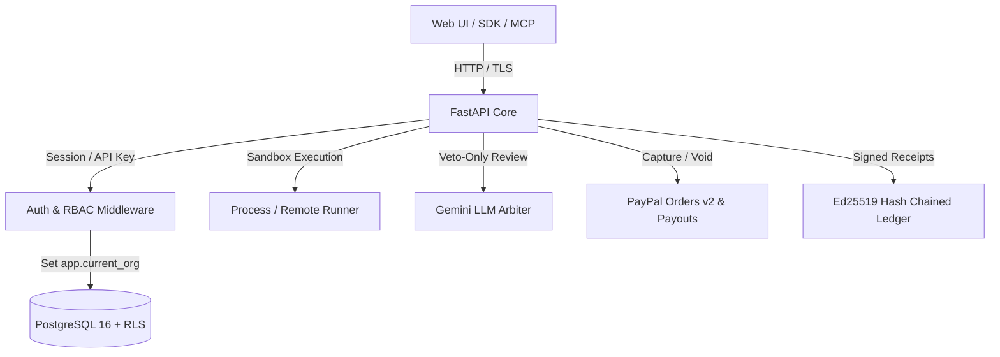

# System Architecture

## Architecture Overview

## Key Components

### 1. PostgreSQL Row-Level Security (RLS)
- Tenant isolation is strictly enforced at the database level.
- All tenant tables have `org_id NOT NULL` and `ENABLE ROW LEVEL SECURITY; FORCE ROW LEVEL SECURITY;`.
- The application connects using the `paylap_app` role (`NOSUPERUSER, NOBYPASSRLS`).
- Every query sets `app.current_org` transactionally. Cross-tenant access is impossible even under SQL injection.

### 2. Hash-Chained Event Ledger
- Append-only event store per contract.
- Each event includes:
  `event_hash = SHA256(prev_event_hash + sequence + event_type + canonical_payload)`.
- Concurrent appends are serialized using PostgreSQL transaction advisory locks (`SELECT pg_advisory_xact_lock(hashtext(contract_id))`).

### 3. Digital Receipts (Receipt v2)
- Settled or voided milestones produce an Ed25519 digital receipt over RFC 8785 canonical JSON.
- Receipts include unguessable share tokens (`shr_...`) for permissionless third-party verification.
- Offline verification CLI `scripts/verify_receipt.py` requires zero database access and zero network connectivity.

### 4. Code Execution Runner
- **`ProcessRunner`**: Local sub-process isolation with AST static scanning, blocked sys-calls, and scrubbed environment.
- **`RemoteRunner`**: Authenticated mutual-TLS gRPC/HTTP proxy to isolated microVM or container sandboxes.
